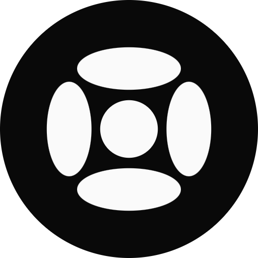
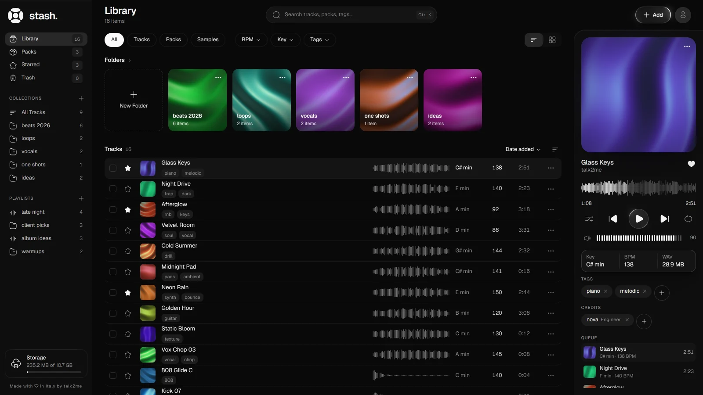

<p align="center">
  
</p>

<h1 align="center">stash.</h1>

<p align="center">Organize your beats, samples and kits on your computer.<br>Free and open source. No account, no cloud, no server.</p>

<p align="center">
  <a href="https://github.com/tk2mw/stash/releases/latest/download/stash-setup.exe"><b>Download for Windows</b></a>
  &nbsp;·&nbsp;
  <a href="https://stashfm.web.app">Website</a>
  &nbsp;·&nbsp;
  <a href="https://github.com/tk2mw/stash/releases">All releases</a>
</p>



## What it does

- **One library for your sounds:** beats, loops, one shots, stems and sound packs (ZIP, RAR, 7z), with folders, playlists, stars and a trash you can undo.
- **Key and BPM** read from the file name, or detected from the audio when you add it.
- **Waveform player** with queue, shuffle, repeat and media keys.
- **Tags and credits** on every track (producer, engineer, featuring…), all searchable with Ctrl K.
- **Packs:** build drum kits, loop kits, MIDI and preset kits with subfolders, then export them as a folder, a ZIP or a RAR (with your own WinRAR).
- **Your files stay yours:** stash keeps them in a folder you pick on your computer, with a size limit you set. Nothing is uploaded anywhere.

## Install

1. Download [`stash-setup.exe`](https://github.com/tk2mw/stash/releases/latest/download/stash-setup.exe) (Windows 10 and 11, 64-bit).
2. Run it. The installer isn't code-signed yet, so Windows SmartScreen may warn you: click **More info → Run anyway**.

Mac and Linux builds aren't available yet; you can run stash from source in Chrome or Edge.

## Run from source

You need [Node.js](https://nodejs.org) 22 or newer.

```bash
npm install
npm run dev        # in the browser, http://localhost:5173 (Chrome or Edge for the folder on disk)
npm run app        # as a desktop app (Electron)
npm run installer  # builds release/stash-setup.exe
```

Built with React, Vite, Tailwind CSS, motion and Electron.

## Support

stash is free. If it helps you, you can [buy me a coffee](https://buymeacoffee.com/talk2me).

## License

[MIT](LICENSE) © 2026 loud4u. Made with ♥ in Italy by talk2me.
